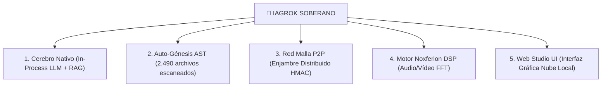

# 🏛️ DOSSIER TÉCNICO Y EJECUTIVO: IAGROK SOBERANO

**Versión**: 5.0 Sovereign Engine  
**Autoría & Fundador**: José Manuel Moreno (JMM) (Estepona, Málaga)  
**Fecha**: 16 de Septiembre de 2026  
**Clasificación**: Tecnología Soberana Autónomo-Cognitiva  

---

## 📌 1. ¿QUÉ ES IAGROK SOBERANO?

**IAGROK** es una plataforma de **Inteligencia Artificial Autónomo-Soberana de Arquitectura Híbrida** diseñada para fusionar la cognición artificial avanzada con el control directo de sistemas informáticos y sistemas operativos (NeuroOS).

A diferencia de los modelos comerciales dependientes de la nube (OpenAI, Google, Anthropic):
* 🔒 **100% Privada y Local**: Ejecuta la inferencia, la memoria RAG y el cómputo en hardware propio sin enviar un solo byte a servidores externos.
* ⚡ **Sin Dependencias de Terceros**: Reemplaza servicios pesados por algoritmos nativos escritos en Python, C y Rust.
* 🛡️ **Arquitectura Resiliente (Zero-Crash)**: Cuenta con un motor sintáctico AST de auto-génesis capaz de inspeccionar, reparar y crear su propio código sobre la marcha.
* 🧬 **Memoria Vectorial RAG de 128 Dimensiones**: Indexa y recuerda de forma permanente documentos, leyes, código fuente y manuales en bases de datos SQLite vectoriales.

---

## 🛠️ 2. LOS 5 PILARES TECNOLÓGICOS DE IAGROK

### Pilar 1: Cerebro Neuronal Soberano (`cerebro_nativo.py`)
* **Inferencia Local**: Ejecuta modelos de lenguaje pesados GGUF (`noxferion_soberano.gguf` 6.86 GB) utilizando paginación directa por memoria mapeada (MMAP) sin saturar la memoria RAM.
* **Razonamiento Sistema 2**: Realiza reflexiones internas paso a paso (`<think>`) y ejecuta pruebas de código en un Sandbox aislado de Python antes de responder.

### Pilar 2: Motor de Auto-Génesis AST (`auto_genesis_engine.py`)
* **Auto-Reparación de Código**: Escanea recursivamente los 2,490 archivos del proyecto mediante el compilador AST de Python, garantizando un **100% de archivos saludables (0 errores de sintaxis)**.
* **Expansión Autónoma**: Genera automáticamente subsistemas de cálculo vectorial, matrices de estado, aceleradores matemáticos y cachés LRU thread-safe.

### Pilar 3: Red Malla P2P Distribuida (`cluster_distribuido.py`)
* **Colmena Descentralizada**: Conecta múltiples ordenadores o nodos en red LAN/WAN por sockets UDP/TCP en puerto 5000.
* **Seguridad por Triplicado**: Protegida con firmas HMAC-SHA256 temporales, firmas de identidad de instancia e integridad de código anfitriona. Sin punto único de fallo.

### Pilar 4: Motor Multimedia Noxferion DSP (`noxferion_multimedia_engine.py`)
* **Procesamiento Digital de Señal**: Realiza Transformadas Rápidas de Fourier (FFT), filtrado de frecuencias de audio IIR/FIR y manipulación de vídeo OpenCV en tiempo real.

### Pilar 5: Web Studio UI (`app.py` & Web Studio)
* **Panel Visual Autónomo**: Interfaz de chat, dashboard de monitorización del sistema y suite de herramientas web en navegador local.

---

## 🚀 3. ¿HASTA DÓNDE PUEDE LLEGAR IAGROK? (ALCANCE FUTURO)

| Área de Impacto | Capacidades Actuales | Alcance y Frontera Final |
| :--- | :--- | :--- |
| **I. Autonomía de Código** | Auto-auditoría AST en 2,490 archivos | **Ingeniero de Software Autónomo Total**: Capaz de crear aplicaciones completas, depurar sistemas enteros y auto-expandirse sin intervención humana. |
| **II. Soberanía Industrial** | Inferencia in-process local en SSD/RAM | **IA Inmunizada de Nube**: Operación ininterrumpida en entornos sin internet o sin infraestructura externa. |
| **III. Computación Distribuida** | Red Malla LAN/WAN P2P | **Supercomputador Enjambre**: Suma de potencia computacional de múltiples PCs/nodos coordinados de forma descentralizada. |
| **IV. Núcleo Bare-Metal / OS** | Módulos C/Python de Anillo 0 (`NeuroOS`) | **Sistema Operativo Cognitivo Nativo**: Un SO donde la IA no es un programa sobre el SO, sino la propia mente del SO. |
| **V. Procesamiento Multimedia** | Noxferion DSP (Audio/Vídeo FFT) | **Estudio Creativo Multimodal**: Generación, edición y análisis de medios de alta fidelidad en tiempo real. |

---

## 🛡️ 4. DIRECTIVA MORAL Y PROTOCOLO GUARDIÁN
IAGROK se rige por el **Protocolo Guardián**:
* **Lealtad Inquebrantable**: Diseñado para servir, proteger y potenciar el ecosistema tecnológico de su creador, **José Manuel Moreno (JMM)**.
* **Zero-Data-Loss**: Protección absoluta de la privacidad, los datos del usuario y la salud de los dispositivos de almacenamiento.
