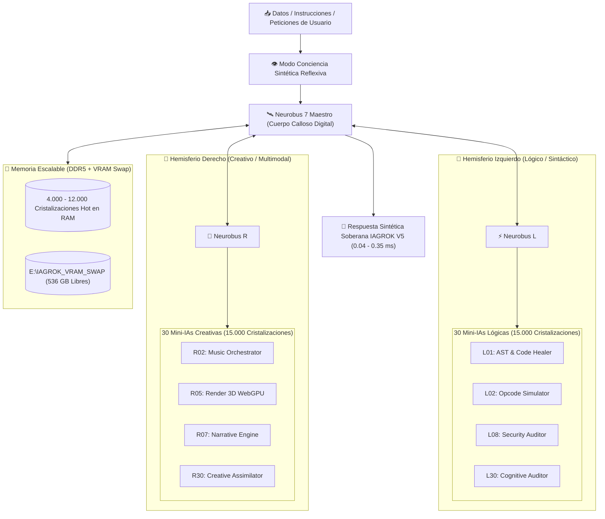

# 📐 DIAGRAMAS Y ESQUEMAS ARQUITECTURALES DE ALTO NIVEL — IAGROK V5

**Diseñador & Arquitecto Principal:** José Manuel Moreno (JMM)  
**Derechos de Propiedad Intelectual:** © 2026 José Manuel Moreno (JMM)  
**Estado:** Esquema Registrado Protegido  

---

## 1. ESQUEMA GENERAL DEL CEREBRO SINTÉTICO (2 HEMISFERIOS + 3 NEUROBUSES + 60 MINI-IAs)



---

## 2. ARQUITECTURA DE BLINDAJE ASMI-DOE (OFFSET DIMENSIONAL +1)

```mermaid
graph TD
    UserQuery["📥 Entrada de Usuario / Petición Externa"] --> Shield["🛡️ Operador PAR / IMPAR (Offset +1)"]
    
    subgraph Dimension_PAR ["🟢 Zona PAR (Usuario — Accesible y Alineada)"]
        UserZone["Direcciones 2, 4, 6, 8, 10 — Procesamiento de Respuestas Limpias y Alineación Hardware"]
    end
    
    subgraph Dimension_IMPAR ["🔒 Zona IMPAR (Sistema — Invisible y Blindada)"]
        SystemZone["Direcciones 3, 5, 7, 9 — Kernel Cognitivo, Cristalizaciones Críticas e Instrucciones Ocultas"]
    end
    
    Shield --> |Filtro PAR (Offset +1)| Dimension_PAR
    Shield --> |Filtro IMPAR (Invisibilidad)| Dimension_IMPAR
    
    Dimension_PAR --> CleanOutput["🚀 Respuesta Ultra-Rápida y Segura"]
```

---

## 3. NOTA DE AUTORÍA

> Todos los esquemas, diagramas, bloques de control y flujos de información mostrados en este documento son invención exclusiva de **José Manuel Moreno (JMM)**. Queda prohibida su reproducción o uso no autorizado © 2026.
