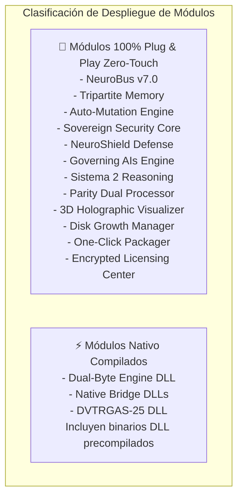

# 🔌 Guía Maestra de Integración de APIs, Archivos de Configuración y Despliegue Plug & Play

Esta guía describe detalladamente para cada uno de los **16 Módulos Comerciales de IAGROK**:
1. Si el módulo es **Plug & Play 100% (Listo para usar sin modificar código)**.
2. Si requiere alguna modificación puntual (indicando **archivo y línea exacta**).
3. Las **APIs / Funciones necesarias**.
4. Los **Archivos de Configuración**.

---



---

## 📋 Ficha Técnica por Módulo

### 1. 🧠 Módulo 1: Dual-Byte Memory Core
* **Modo**: ⚡ **Plug & Play** (DLL `.dll` ya compilada en `-O3`).
* **Archivos de Configuración**: N/A (Operaciones en registro bitwise).
* **APIs Necesarias**:
  ```python
  from dual_byte_bridge import DualByteEngine
  engine = DualByteEngine()
  b = engine.empaquetar(fuerza_directa=12, fuerza_retorno=9)
  fwd, rev = engine.desempaquetar(b)
  ```
* **¿Qué modificar si se cambia de SO/CPU?**: Si se migra de Windows x86_64 a ARM64/Linux, recompilar `dual_byte_core.c` con `gcc -O3 -shared -o dual_byte_core.dll dual_byte_core.c` (Línea 1).

---

### 2. 📡 Módulo 2: NeuroBus v7.0 Symbiotic Bus
* **Modo**: 🔌 **Plug & Play 100% Zero-Touch**.
* **Archivos de Configuración**: Ninguno.
* **APIs Necesarias**:
  ```python
  from neurobus_standalone import NeuroBusStandalone
  bus = NeuroBusStandalone()
  bus.on("canal.eventos", mi_callback)
  bus.emit("canal.eventos", {"datos": 123})
  ```

---

### 3. 🧠 Módulo 3: Tripartite Cognitive Memory Engine
* **Modo**: 🔌 **Plug & Play 100%**.
* **Archivos de Configuración**: Auto-crea `tripartite_commercial.db` en la primera ejecución.
* **Modificaciones opcionales**:
  * Para cambiar la capacidad por lóbulo (de 500 a 1000), edite la línea `NODULO_CAPACIDAD = 500` en `tripartite_memory_standalone.py` (Línea 14).
* **APIs Necesarias**:
  ```python
  from tripartite_memory_standalone import TripartiteMemoryEngine
  mem = TripartiteMemoryEngine()
  id_mem = mem.guardar_cristalizacion(dominio="hardware", contenido="...", respuesta="...")
  ```

---

### 4. ⚡ Módulo 4: Transactional Auto-Mutation Engine
* **Modo**: 🔌 **Plug & Play 100%**.
* **Archivos de Configuración**: Directo de backups configurable en inicialización (`backup_dir="./backups_modulos"`).
* **APIs Necesarias**:
  ```python
  from transactional_mutation_engine import TransactionalMutationEngine
  engine = TransactionalMutationEngine()
  exito = engine.aplicar_mutacion_segura("script.py", nuevo_codigo_str)
  ```

---

### 5. 🦀 Módulo 5: Triple-Engine Hybrid Native Bridge
* **Modo**: ⚡ **Plug & Play**.
* **Archivos de Configuración**: Busca `c_core.dll` y `rust_core.dll`.
* **APIs Necesarias**:
  ```python
  from native_bridge_standalone import TripleEngineBridge
  bridge = TripleEngineBridge()
  status = bridge.obtener_estado_motores()
  ```

---

### 6. 🐝 Módulo 6: Hive Cloning Engine
* **Modo**: 🔌 **Plug & Play 100%**.
* **Archivos de Configuración**: Token Soberano HMAC.
* **APIs Necesarias**:
  ```python
  from hive_cloning_core import HiveCloningEngine
  hive = HiveCloningEngine()
  hive.autorizar_dispositivo("TOKEN_CREADOR", "192.168.1.50")
  pkg = hive.generar_paquete_clonacion(["modulo.py"])
  ```

---

### 7. 🛡️ Módulo 7: Distributed Sovereign Security Core
* **Modo**: 🔌 **Plug & Play 100%**.
* **Archivos de Configuración**: `allowed_directory="./sandbox"` (Configurable en instancia).
* **APIs Necesarias**:
  ```python
  from distributed_security_core import SovereignSecurityEngine
  sec = SovereignSecurityEngine(allowed_directory="./sandbox")
  ok = sec.verificar_escritura_sandbox("./sandbox/file.txt")
  ```

---

### 8. 🏎️ Módulo 8: DVTRGAS-25 Runtime Core
* **Modo**: ⚡ **Plug & Play**.
* **Archivos de Configuración**: `dvtrgas25_engine.dll` precompilado.
* **APIs Necesarias**:
  ```python
  from dvtrgas25_bridge import DVTRGAS25Bridge
  engine = DVTRGAS25Bridge()
  engine.inicializar(1920, 1080)
  throughput = engine.renderizar_frame_neural(1.0) # 2.84 GB/s
  ```

---

### 9. 🛡️ Módulo 9: NeuroShield Cognitive Defense Engine
* **Modo**: 🔌 **Plug & Play 100%**.
* **Archivos de Configuración**: Umbral de activación por defecto `85.0%` en línea 16 de `neuroshield_standalone.py`.
* **APIs Necesarias**:
  ```python
  from neuroshield_standalone import NeuroShieldEngine
  shield = NeuroShieldEngine()
  res = shield.evaluar_estres_hardware(cpu_pct=91.0, ram_pct=88.0)
  ```

---

### 10. 🧠 Módulo 10: Distributed Governing AIs Engine
* **Modo**: 🔌 **Plug & Play 100%**.
* **Archivos de Configuración**: Ninguno.
* **APIs Necesarias**:
  ```python
  from distributed_ais_core import DistributedAIsOrchestrator
  net = DistributedAIsOrchestrator()
  res = net.adjudicar_y_distribuir("Diagnostico de CPU")
  ```

---

### 11. 🧠 Módulo 11: Sistema 2 Reasoning Engine
* **Modo**: 🔌 **Plug & Play 100%**.
* **Archivos de Configuración**: Ninguno.
* **APIs Necesarias**:
  ```python
  from sistema2_reasoning_core import Sistema2ReasoningEngine
  s2 = Sistema2ReasoningEngine()
  res = s2.razonar_profundo("Explicacion tecnica")
  ```

---

### 12. ⚙️ Módulo 12: Parity Dual Processor
* **Modo**: 🔌 **Plug & Play 100%**.
* **Archivos de Configuración**: Ninguno.
* **APIs Necesarias**:
  ```python
  from parity_processor_core import ParityDualProcessor
  pdp = ParityDualProcessor()
  res = pdp.procesar_tarea({"tarea": "Optimizacion"})
  ```

---

### 13. 🌌 Módulo 13: 3D Holographic Brain Visualizer
* **Modo**: 🔌 **Plug & Play 100% WebGL**.
* **Archivos de Configuración**: N/A. Abrir directamente `brain_3d_renderer.html` o embeber mediante `<iframe src="brain_3d_renderer.html"></iframe>`.

---

### 14. 💾 Módulo 14: Sovereign Disk Growth Manager
* **Modo**: 🔌 **Plug & Play 100%**.
* **Archivos de Configuración**: Configurable al instanciar (`target_dir="./logs"`, `max_size_mb=50.0`).
* **APIs Necesarias**:
  ```python
  from disk_growth_manager import SovereignDiskGrowthManager
  mgr = SovereignDiskGrowthManager(target_dir="./logs", max_size_mb=50.0)
  mgr.auditar_y_limpiar()
  ```

---

### 15. 📦 Módulo 15: One-Click Executable Packager
* **Modo**: 🔌 **Plug & Play 100%**.
* **Archivos de Configuración**: Genera automáticamente `.spec` para PyInstaller.
* **APIs Necesarias**:
  ```python
  from standalone_packager import OneClickPackager
  pkg = OneClickPackager()
  spec_path = pkg.generar_spec_soberano("app.py", "MiAppExecutable")
  ```

---

### 16. 🔐 Módulo 16: Sovereign Encrypted Licensing & OTA Updates
* **Modo**: 🔌 **Plug & Play 100%**.
* **Archivos de Configuración**: Auto-crea `licencias_soberanas_emitidas.json`.
* **Llave Maestra Cifrada**: En `sovereign_license_manager.py` (Línea 12: `MASTER_SECRET = "IAGROK_SOVEREIGN_MASTER_KEY_..."`). Modificar únicamente si se desea cambiar la firma criptográfica maestra.
* **APIs Necesarias**:
  ```python
  from sovereign_license_manager import SovereignLicenseManager
  mgr = SovereignLicenseManager()
  lic = mgr.generar_licencia(usuario_nombre="Cliente_01", empresa_cliente="Empresa_A", tipo_licencia="TRIAL_30_DIAS")
  valida = mgr.verificar_licencia_token(lic["token_licencia"], hardware_uuid="HW-1234")
  ```

---
*Autoría y Soporte*: **José Manuel Moreno (JMM) (Noxferion / Cyberenigma)**
