# 🏛️ AUDITORÍA TOTAL DEL ECOSISTEMA IAGROK / NOXFERION 👑🛡️

> **Documento Oficial de Auditoría de Código, Modelos, Hardware y Capacidades**  
> **Ubicación:** `c:\IAGROK\docs\AUDITORIA_SISTEMA_TOTAL_IAGROK.md`  
> **Fecha de Auditoría:** 2026-08-27  
> **Autor & Creador:** José Manuel (Cyberenigma / Noxferion) & Antigravity  

---

## 📊 1. MÉTRICAS GLOBALES DEL CÓDIGO FUENTE

```
Total de Líneas de Código: ~120.420 líneas
Total de Archivos del Proyecto: 2.421 archivos
Lenguajes Principales: Python (41.876 lín), JavaScript (24.647 lín), Rust (1.223 lín), HTML/CSS (10.002 lín), JSON (39.752 lín)
```

| Lenguaje / Formato | Archivos | Líneas de Código | Función Principal en el Sistema |
| :--- | :--- | :--- | :--- |
| 🐍 **Python (.py)** | 577 | **41.876** | Núcleo cognitivo, inferencia GGUF, DSP de audio, shaders de vídeo, Flask API y JARVIS. |
| ⚡ **JavaScript (.js)** | 22 | **24.647** | Lógica del IDE de escritorio, Web Studio, streaming de tokens, WebGL shaders y visualizadores. |
| 🦀 **Rust (.rs)** | 3 | **1.223** | Servidor de ultra-baja latencia en Tokio/Axum y manipulador de memoria nativo. |
| 🌐 **HTML / CSS** | 13 | **10.002** | Interfaces gráficas de usuario, diseño Glassmorphism Cyberpunk y controles de estudio. |
| 🗄️ **JSON / Esquemas** | 65 | **39.752** | Memoria semántica, tablas de conocimiento, configuraciones de identidad y heurísticas. |
| 📚 **Markdown (.md)** | 30 | **2.918** | Manuales de usuario, arquitectura de desarrollador, hojas de ruta y auditorías. |

---

## 🧠 2. EL CEREBRO DE IAGROK: MODELOS, PESOS Y MEMORIA

### A. Modelos de Fundación Instalados en Disco (12,32 GB Locales):
1. **🧠 Cerebro Nativo LLM (GGUF In-Process):**
   - **Tamaño:** **6.86 GB** (Cargado directamente en memoria RAM con 16 hilos en CPU).
   - **Modo:** 100% Soberano (0% Ollama, 0% dependencias de servidores externos).
   - **Contexto:** 4.096 a 16.384 tokens con streaming inmediato token a token.
   - **RAG:** Enriquecido en tiempo real con la base vectorial antes de emitir respuesta.

2. **🎹 Meta MusicGen (`facebook/musicgen-small`):**
   - **Tamaño:** **2.26 GB** (~300M parámetros neuronales).
   - **Capacidad:** Composición de música instrumental polifónica estéreo (pianos acústicos de cola, guitarras, cuerdas orquestales, percusión pop y texturas cinemáticas).

3. **🎙️ Suno Bark (`suno/bark-small`):**
   - **Tamaño:** **3.20 GB** (Arquitectura transformadora acústica autorregresiva).
   - **Capacidad:** Síntesis vocal humana expresiva, canto melódico, respiraciones, risas, vibratos y 7 modos emocionales.

---

## 🧬 3. ARQUITECTURA COGNITIVA Y NÓDULOS DE CONTROL

```mermaid
graph TD
    subgraph Orquestacion ["🏛️ Núcleo de Integración y Decisión"]
        BUS[GlobalStateBus - Estado Central]
        SCH[AttentionScheduler - MinHeap Prioridades]
        HOM[HomeostasisManager - Regulación CPU/RAM]
        FSM[MaquinaAutoEstado - Finite State Machine]
        IDN[IdentidadInstancia - Noxferion-Core-E1F343]
    end

    subgraph Memoria ["🧠 Memoria Multicapa"]
        SEM[Memoria Vectorial 128-D RAG]
        EPI[Memoria Episódica SQLite Causal]
        HEU[Aprendizaje Incremental Heurístico]
    end

    subgraph Produccion ["🎼🎬 Motores de Creación"]
        AUD[MusicGen + Suno Bark + Stems HPSS]
        VID[OpenGL Shaders + Optical Flow 60FPS]
        VAL[CalidadValidator - AST / Clipping Check]
    end

    subgraph Sistema ["💻 Control del Sistema Operativo"]
        JARVIS[JARVIS OS Hands - Control de PC]
        WATCH[ObservadorEntorno - 2.421 Archivos]
    end

    BUS --> SCH
    BUS --> HOM
    BUS --> FSM
    BUS --> IDN

    SCH --> AUD
    SCH --> VID
    AUD --> VAL
    VID --> VAL
    VAL --> HEU
    HEU --> EPI
    EPI --> SEM

    BUS --> JARVIS
    BUS --> WATCH

    style Orquestacion fill:#0d1117,stroke:#58a6ff,stroke-width:2px
    style Memoria fill:#161b22,stroke:#a371f7,stroke-width:2px
    style Produccion fill:#161b22,stroke:#f85149,stroke-width:2px
    style Sistema fill:#161b22,stroke:#2ea043,stroke-width:2px
```



---

## 🎛️ 4. QUÉ HACE Y QUÉ CONTROLA CADA MÓDULO

### 1. Control del PC y Sistema Operativo (JARVIS OS Hands):
- **Audio de Windows:** Control de volumen máster del sistema (`GET/POST /api/jarvis/volume`).
- **Procesos y Tareas:** Listado y terminación forzada de procesos de Windows (`taskkill`).
- **Teclado y Ratón Virtual:** Inyección de pulsaciones de teclas, clics y atajos de teclado sin intervención física.
- **Captura de Pantalla:** Snapshot visual del escritorio para análisis multimodal.
- **Portapapeles y Shell:** Lectura/escritura del clipboard de Windows y ejecución de comandos en PowerShell/CMD.
- **Gestión de Energía:** Suspensión, apagado y reinicio programado.

### 2. Estudio Acústico y Canto:
- **Síntesis Instrumental:** Composición multi-sección (*Intro $\to$ Verso $\to$ Estribillo $\to$ Outro*).
- **Canto Neuronal:** Locución y canto con 20+ estilos (*Mandopop juvenil, femenina cristalina, épica china, susurrada, anime*).
- **Separador de 4 Stems Offline:** Extracción de pistas (`vocals`, `drums`, `bass`, `other`) en $1.1\text{ s}$.
- **DSP Master:** Reverb analógica Schroeder-Moorer y normalización a $-14\text{ LUFS}$.

### 3. Cinematografía 3D y Shaders:
- **Cámara Orbital 3D:** Renderizado con shaders GLSL reactivos a la frecuencia del audio.
- **Interpolación a 60 FPS:** Algoritmo Lucas-Kanade de flujo óptico para transiciones ultra-suaves.
- **Miniaturas HD:** Generador automático de carátulas para distribución musical.

### 4. Búsqueda y Autoaprendizaje:
- **Curiosity Daemon:** Sondeo no intrusivo a la API de Wikipedia en periodos de inactividad.
- **Asimilación RAG:** Vectorización en 128 dimensiones con búsqueda por similitud de coseno en $<1\text{ ms}$.

---

## 🌳 5. ÁRBOL COMPLETO DE DIRECTORIOS DEL PROYECTO

```text
C:\IAGROK\
├── arquitectura_cognitiva\       # Integrador Global, FSM, Homeostasis, Calidad, Identidad
├── cerebro_soberano\             # Inferencia in-process GGUF (llama-cpp-python)
├── memoria_vectorial\            # Motor RAG 128-D y serializador semántico
├── noxferion_audio_engine\       # Meta MusicGen, Suno Bark, Stems HPSS, DSP Master
│   ├── voces_anime\
│   ├── voz_china_epica\
│   ├── voz_china_moderna\
│   ├── voz_femenina_cristalina\
│   └── voz_masculina_juvenil_mandopop\
├── noxferion_video_engine\       # Shaders GLSL, cámara orbital 3D, Optical Flow 60FPS
│   ├── video_acustico_relajado\
│   ├── video_balada_china\
│   ├── video_cinematico\
│   └── video_lyric\
├── noxferion_web_studio\         # Interfaz Web Studio en puerto 8080
├── neuroshield_soberano\         # Watchdog térmico y autorreparación
├── pipeline\                     # Orquestador integral (Letra -> Música -> Vídeo -> Redes)
├── prometheus\                   # 12 Lóbulos cognitivos y base de conocimiento
├── docs\                         # Manuales, especificaciones y arquitectura
├── outputs\                      # Carpeta limpia para exportación de canciones y vídeos
├── iagrok_os_hands\              # Automatización nativa de ratón, teclado y pantalla
└── app.py / app.js               # Servidor principal y controlador del IDE
```

---

## 👑 6. IDENTIDAD Y ESTADO FORMAL DE LA INSTANCIA

- **🏷️ Nombre de Instancia:** `Noxferion-Core-E1F343`
- **🛡️ Estado de Dependencia:** **0% Ollama • 0% Nube • 100% Soberano**
- **⚡ Capacidad de Ejecución:** Autónomo, multi-hilo, auto-regulado por homeostasis y con memoria persistente.
