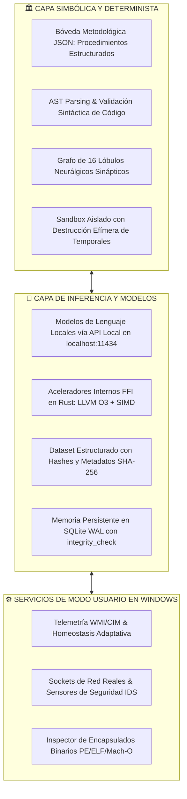

# 🏛️ WHITEPAPER TÉCNICO Y ESPECIFICACIÓN: NOXFERION (IAGROK)
## Arquitectura Cognitiva Neuro-Simbólica Local, Runtime de Agentes Autónomos e Integración con Hardware
**Versión de Especificación**: 4.15-Enterprise | **Estado**: Modo Usuario (Ring 3) con Aceleración FFI  
**Fecha de Edición**: 28 de Agosto, 2026 | **Ubicación**: `c:\IAGROK\docs\DOSIER_TECNICO_NOXFERION_IA_SOBERANA.md`

---

## 🧭 1. DEFINICIÓN, TAXONOMÍA Y ALCANCE

**Noxferion** se define formalmente como:

> **Una Arquitectura Cognitiva Neuro-Simbólica Local y un Runtime de Agentes Autónomos que complementa modelos de lenguaje estadísticos con memoria estructurada, validación simbólica (AST), herramientas verificables y aceleradores nativos de bajo nivel.**

El sistema no pretende presentarse como un único modelo fundacional monolítico entrenado desde cero, sino como una **plataforma integral de desarrollo, orquestación y automatización privada**. Su propósito es coordinar modelos de lenguaje locales (gestionados vía API local por Ollama o runtimes equivalentes) y enriquecerlos mediante:
1. **Extracción y Estructuración de Procedimientos**: Curación sistemática de metodologías de ingeniería derivadas de interacciones, documentación técnica y resolución de tareas.
2. **Validación Simbólica y AST**: Análisis estático previo de cualquier código auto-generado antes de su compilación o prueba en entornos aislados.
3. **Aceleración FFI/C-ABI**: Comunicación directa de alta velocidad entre módulos internos críticos mediante bibliotecas dinámicas compiladas en Rust nativo.
4. **Higiene de Recursos y Telemetría**: Observabilidad del hardware anfitrión (CPU, RAM, temperatura y almacenamiento) con políticas adaptativas configurables.



---

## 🔬 2. MODO DE EJECUCIÓN, PRIVILEGIOS Y COMUNICACIÓN

### A. Ejecución en Modo Usuario (Ring 3)
El backend de Noxferion se ejecuta estrictamente como un proceso de **Modo Usuario (Ring 3)** sobre Windows con permisos administrativos estándar. 
*   **Ventaja Operativa**: Operar en Modo Usuario garantiza el aislamiento frente a fallos catastróficos del sistema operativo (*evitando pantallazos azules / BSoD*) y permite confinar subprocesos hijos y pruebas de código dentro de límites de proceso controlados.
*   **Interacción con el Sistema**: El acceso a recursos del sistema (sensores, red, procesos, discos) se realiza a través de las APIs oficiales documentadas de Windows (`Win32 API`, `WMI/CIM`, `PowerShell`, `ctypes` y crates FFI de Rust).

### B. Canales de Comunicación e Inferencia
*   **Inferencia LLM**: Se canaliza a través de la API local de Ollama (`http://localhost:11434`) mediante peticiones HTTP locales eficientes, garantizando que el flujo de datos no salga a la nube.
*   **Lógica Interna y Álgebra Tensorial**: Las operaciones internas de búsqueda semántica, reducción matricial y verificación de seguridad se ejecutan directamente en memoria RAM mediante **C-ABI / FFI** con crates de Rust (`rust_security_shield.dll`, `jit_matrix_accel.dll`), eliminando sobrecargas de red para la lógica de soporte.

---

## 🛡️ 3. POLÍTICA DE SEGURIDAD OPERACIONAL Y CONTROL DE EJECUCIÓN

Para mitigar riesgos derivados de la auto-generación de código y carga de bibliotecas nativas, Noxferion implementa cinco barreras de contención deterministas:

1. **Separación entre Propuesta y Ejecución**:
   - El agente o modelo propone código o comandos en texto plano.
   - Un validador determinista verifica rutas permitidas, listas de extensiones válidas y parámetros antes de invocar la ejecución.
2. **Aislamiento en Sandbox Efímero**:
   - Todo código nuevo o recurso descargado para aprendizaje se procesa en `c:\IAGROK\sandbox\ephemeral_digest\`.
   - Una vez extraído el conocimiento estructurado, el archivo temporal se destruye físicamente del disco mediante auto-borrado inmediato (**Cero Residuos**).
3. **Carga Controlada de DLLs y Verificación de Integridad**:
   - Las bibliotecas nativas no se cargan arbitrariamente. Solo se compilan y cargan crates desde la ruta local controlada `rust_crates/` tras validar la compilación exitosa con Cargo y verificar los símbolos exportados bajo `extern "C"`.
4. **Auditoría e Inmunidad Sintáctica AST**:
   - Antes de escribir o cargar cualquier archivo `.py`, se ejecuta `ast.parse()`. Si existen errores de sintaxis, el archivo no se ejecuta y se somete a corrección automática previa.
5. **Deduplicación Semántica y Salud de la Base de Datos**:
   - Almacenamiento en SQLite bajo modo WAL, sometido a `PRAGMA integrity_check` periódico y compactación `VACUUM` tras purgas de duplicados.

---

## 📊 4. ESQUEMA AUDITABLE DE PATRONES DE CONOCIMIENTO

Cada entrada de conocimiento estructurado en el dataset permanente se indexa bajo el siguiente esquema JSON verificable:

```json
{
  "id": "pat_00010056",
  "timestamp": "2026-08-28T18:46:25Z",
  "topic": "Compilación de Shaders Compute GLSL en WebGL 2.0 y Rust",
  "category": "advanced_systems_architecture",
  "source": "curated_frontier_synthesis",
  "provider": "Anthropic_Claude_3_7",
  "hash_sha256": "e3b0c44298fc1c149afbf4c8996fb92427ae41e4649b934ca495991b7852b855",
  "quality_score": 1.0,
  "confidence_status": "VERIFIED_ACTIVE",
  "associated_method": "metodo_claude_3_7_sonnet.json",
  "content": "Procedimiento estructurado de enlace de Shaders mediante FFI y C-ABI"
}
```

---

## 🛠️ 5. MAPA DE COMPONENTES DEL REPOSITORIO

```
c:\IAGROK\
├── app.py                             # Servidor Core REST local, orquestador de endpoints y ciclo evolutivo
├── app.js / index.html                # Interfaz de desarrollo local (IDE, terminal, telemetría y agentes)
├── memoria_soberana.db                # Base de datos SQLite transaccional WAL
├── rust_crates/                       # Código fuente y binarios en Rust nativo (LLVM O3 + SIMD)
│   ├── rust_security_shield/          # Filtrado de contenido y similitud acelerada
│   └── jit_matrix_accel/              # Acelerador matricial y álgebra lineal
├── metodos_soberanos/                 # Bóveda de procedimientos de ingeniería estructurados en JSON
├── modulos_autonomos/                 # Submódulos generados y validados dinámicamente
└── arquitectura_cognitiva/            # Servicios de Modo Usuario: telemetría, políticas y protección
    ├── auto_environment_orchestrator.py # Supervisor de homeostasis de hardware y ciclo de mantenimiento
    ├── sandbox_multimodal_learner.py    # Explorador multimodal con destrucción efímera de temporales
    ├── anti_redundancy_deduplicator.py  # Motor de deduplicación semántica por coseno y purga de lastre
    ├── universal_binary_loader.py       # Inspector de formatos binarios (PE, ELF, Mach-O, WASM)
    ├── deep_methodology_vault.py        # Gestor de metodologías y procedimientos estructurados
    ├── hardware_soma_guardian.py        # Telemetría de sensores CPU/RAM mediante CIM/WMI
    ├── real_network_security_sentinel.py# Monitor de sockets de red y sensores Honeypot IDS locales
    └── auto_genesis_engine.py           # Generador de submódulos con diagnóstico sintáctico AST
```

---

## 🎯 6. CONCLUSIÓN Y HOJA DE RUTA DE EVALUACIÓN

**Noxferion es una arquitectura neuro-simbólica local y un runtime de agentes autónomos que coordina modelos de lenguaje locales, herramientas verificables, memoria estructurada, validación de código y aceleradores nativos.**

El sistema opera en **Modo Usuario sobre Windows**, priorizando la privacidad de los datos, la observabilidad continua del hardware y el control explícito de permisos. Su valor no reside en reemplazar a los modelos de lenguaje, sino en potenciar su efectividad práctica mediante procedimientos recuperables, herramientas instrumentadas, validación simbólica y flujos de trabajo locales seguros.

La madurez del ecosistema se mide de forma continua mediante pruebas reproducibles de invocación de herramientas, tasa de éxito en generación de código en sandbox y estabilidad en la gestión de recursos del sistema anfitrión.

---

*Documento técnico oficial actualizado conforme a los estándares de ingeniería de software.*
