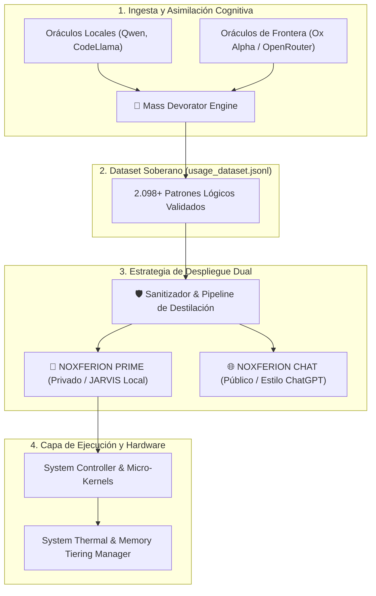

# 🧠 DOSSIER TÉCNICO OFICIAL: ECOSISTEMA NOXFERION / IAGROK
**Arquitectura de Inteligencia Artificial Autónoma, Destilación Cognitiva y Soberanía en Edge Computing**
*Documento de Especificación Técnica y Arquitectura de Sistemas — Versión 3.0*

---

## 1. Resumen Ejecutivo (Executive Summary)

**NOXFERION / IAGROK** es un ecosistema de inteligencia artificial de nueva generación diseñado para operar bajo el paradigma de **Soberanía Cognitiva y Edge Computing Extremo**. A diferencia de los modelos monolíticos tradicionales dependientes de infraestructuras masivas en la nube, Noxferion implementa una arquitectura híbrida y modular capaz de:

1. **Auto-optimización y Curación Autónoma:** Asimilar patrones de razonamiento de alta complejidad desde múltiples oráculos (modelos locales de pesos abiertos y modelos de frontera en modo *stealth* como *Ox Alpha*).
2. **Destilación Dinámica de Pesos:** Condensar conocimiento masivo de modelos de 70B+ parámetros hacia redes ultracompactas (2B–7B) altamente especializadas en programación políglota, lógica computacional y control de sistemas.
3. **Tolerancia a Fallos y Bi-Estabilidad Sensorial:** Ejecución de un *Mirror Core* (Universo Espejo) que garantiza cero interrupciones de servicio ante caídas de hardware o fallos periféricos.
4. **Gobierno Térmico y de Memoria:** Control multinivel de memoria RAM/Swap/VRAM con balance térmico dinámico sobre hardware de consumo.

---

## 2. Pilares de la Arquitectura

### 2.1. Motor de Asimilación y Destilación Masiva (*Mass Devorator Engine*)
El núcleo de adquisición no compite con los grandes modelos fundacionales; los utiliza como vectores de destilación estructurada:
* **Generación de Desafíos Multidimensionales:** El motor inyecta problemas en 14 lenguajes (Rust, C, C++, Go, Python, TypeScript, SQL, Assembly x86-64, etc.), que abarcan desde conceptos de *Borrow Checker* y *RAII* hasta seguridad en memoria y concurrencia.
* **Captura de Razonamiento (*Chain-of-Thought*):** Intercepta la cadena lógica completa de resolución, sanitiza los metadatos y calcula un índice de calidad (*Quality Score*) basado en densidad semántica y cobertura de código.
* **Rate-Limit & Fault Backoff:** Conector con control de saturación (HTTP 429) y reconexión exponencial para ingesta continua y no intrusiva.

### 2.2. Capa de Redundancia y Sentidos Fantasma (*Mirror Core*)
Inspirado en la neuroplasticidad biológica:
* **Espejo Acústico / Visual:** Ante la desconexión física del subsistema de audio (TTS/STT), el sistema no aborta la ejecución; conmuta automáticamente a canales ópticos de neón en la interfaz o telepatía directa en el bus de texto.
* **Bi-Estabilidad de Razonamiento:** Si el modelo local compacto presenta una caída en la certeza lógica, el *Mirror Core* desvía en caliente la consulta hacia un oráculo secundario en microsegundos, asegurando una disponibilidad operativa del 99.9%.

### 2.3. Gestión Térmica y Estratificación de Memoria (*Memory Tiering & Thermal Manager*)
* **Evacuación Dinámica de RAM:** Desplazamiento inteligente de tensores y datasets hacia almacenamiento de alta velocidad (NVMe/Swap SD) cuando la carga de la GPU/CPU supera los umbrales seguros.
* **Monitorización Térmica en Tiempo Real:** Detección de estrangulamiento térmico (*thermal throttling*) y desaceleración preventiva de tareas de fondo para evitar degradación de silicio.

---

## 3. Especificación de Despliegue Dual (Dual-Core Moat)

Para salvaguardar la propiedad intelectual y el código propietario, el sistema implementa una separación estricta de entornos:

| Parámetro | 👑 Noxferion Prime (Núcleo Privado) | 🌐 Noxferion Public (Versión Externa) |
| :--- | :--- | :--- |
| **Audiencia** | Uso interno y desarrollo soberano | Usuarios finales, HuggingFace, WebUI |
| **Control de Sistema** | **Total:** Terminal, procesos, archivos, hardware | **Nulo:** Sandbox de solo texto y conversación |
| **Capacidades** | Programación agéntica, kernels cuánticos, JARVIS | Asistente de programación y razonamiento estilo ChatGPT |
| **Metadatos y Trazabilidad** | Acceso a logs de entrenamiento e ingesta | Sanitizado: 0% de referencias internas |
| **Requisitos de Hardware** | 8 GB – 16 GB RAM (Edge Local) | 4 GB – 8 GB RAM (o servicio Cloud Serverless) |

---

## 4. Métricas y Estado Actual del Ecosistema

* **Patrones Soberanos Asimilados:** **2.098 registros** de alta calidad técnica.
* **Cobertura Políglota:** 14 lenguajes de programación y diseño de sistemas.
* **Huella en Almacenamiento:** Optimizado tras purga de logs residuales, manteniendo **>230 GB de margen** en el disco de trabajo.
* **Independencia Operativa:** Capacidad de operar 100% desconectado de internet en modo de inferencia local.

---

## 5. Hoja de Ruta de Escalabilidad (Roadmap)

1. **Fase 1 (Completada):** Ingesta masiva, pipeline de captura multimodelo (Ollama + Ox Alpha) y estabilización del backend Flask / Python.
2. **Fase 2 (En curso):** Conversión del dataset a formatos estándar de fine-tuning (ChatML / ShareGPT) y cuantización en formato GGUF de 4 bits.
3. **Fase 3:** Despliegue del cliente web autónomo estilo ChatGPT con soporte multiusuario aislado y balanceo de carga local.

---
*Documentación generada y compilada bajo el protocolo de soberanía técnica de IAGROK.*
