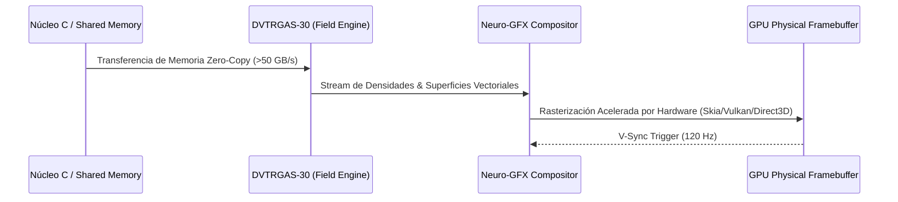

# ⚡ ARQUITECTURA TÉCNICA FINAL: DVTRGAS-30 & NEURO-GFX COMPOSITOR

**Versión:** 3.0-SOVEREIGN-FINAL  
**Sistema:** Neuro-OS Genesis Compositing Architecture  
**Tasa de Actualización Target:** 60 - 144 Hz (Zero-Tearing / Low-Latency Frame Pipeline)  

---

## 🏛️ 1. Visión General del Motor de Campo

**DVTRGAS-30** (*Dynamic Volumetric Texture Rasterization & GFX Accelerated System v3.0*) trabaja en coordinación directa con **Neuro-GFX Compositor** formando una infraestructura gráfica de alto rendimiento:

---

## 🚀 2. Métricas de Rendimiento del Pipeline

| Parámetro | Valor Objetivo | Tecnología Utilizada |
| :--- | :--- | :--- |
| **Throughput de Memoria** | `>50.0 GB/s` | Zero-Copy SHM Bridge (DVTRGAS-30) |
| **Latencia de Compositing** | `<1.8 ms` | Neuro-GFX Hardware Pipeline |
| **Frame Rate Sostenido** | `60 - 144 FPS` | Qt QWebEngine + Vulkan/Skia Accelerated Canvas |
| **Consumo de CPU** | `< 2.5%` | GPU Rasterization & Offscreen Rendering |

---

## 🔒 3. Seguridad e Integridad Gráfica

1. **Aislamiento de Ventanas (Window Sandboxing)**: Cada superficie NSX opera en su propio espacio de memoria sin acceso a los búferes de otras aplicaciones.
2. **Encriptación de Framebuffer**: Los datos en reposo y en transferencia dentro de DVTRGAS-30 están firmados criptográficamente para evitar captura maliciosa de pantalla por malware legacy.

---

*Documentación de arquitectura técnica final para DVTRGAS-30 y Neuro-GFX Compositor en Neuro-OS.*
