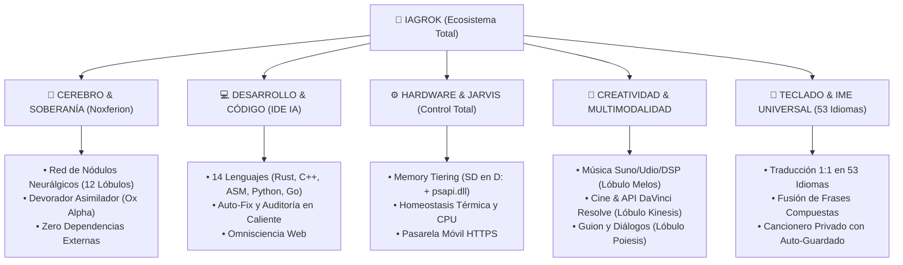

# ⚡ INFORME TÉCNICO EJECUTIVO: CAPACIDADES TOTALES DE IAGROK Y NOXFERION
**Clasificación:** Confidencial / Soberano  
**Ecosistema:** IAGROK Intelligence Suite  
**Núcleo:** Noxferion Prime (2.265+ Patrones Asimilados)  
**Fecha de Emisión:** 25 de Agosto de 2026  

---

## 🧭 Resumen Ejecutivo
**IAGROK** es una suite de inteligencia artificial integral, autónoma y de soberanía digital. Combina un entorno de desarrollo de software de bajo nivel, un motor de control de hardware de precisión (*JARVIS*), un sistema de memoria neuronal viva con 12 lóbulos cerebrales y una dimensión creativa multimodal (música, vídeo y guionización).

---

## 1. 🧠 Núcleo de Inteligencia Soberana (Noxferion Prime)
* **Independencia Total y Cero Telemetría:** Funciona 100% en local sin enviar código ni datos a servidores de terceros.
* **Lóbulo Central Creativo e Hiperconexión Multisectorial (`neuralgic_nodes_network.py`):**
  - **Hub Central:** `LOBULO_CENTRAL_CREATIVO` (Orquestador y Director Artístico Supremo).
  - **Matriz de 6 Sectores Funcionales (13 Lóbulos Fundacionales + Nódulos Dinámicos):**
    1. **Sector Creativo Central:** `LOBULO_CENTRAL_CREATIVO`.
    2. **Sector Arte y Multimodal:** `LOBULO_MELOS_AUDIO_MUSIC` (Suno/DSP/SVS), `LOBULO_KINESIS_CINEMA_VIDEO` (DaVinci/Sora), `LOBULO_POIESIS_CREATIVE_STORY` (Guion/Lore).
    3. **Sector Lógico y Sintáctico:** `LOBULO_LOGOS_SINTAXIS`, `LOBULO_POLYGLOT_CORE` (Rust, C++, Go, ASM).
    4. **Sector Rendimiento y Hardware:** `LOBULO_PNEUMA_OPTIMIZACION` (UPL/Memoria), `LOBULO_JARVIS_HARDWARE` (GPU/Telemetría).
    5. **Sector Cuántico y Estructural:** `LOBULO_QUANTUM_KERNEL` (Hilbert/Polirritmia Cuántica), `LOBULO_NOUS_ARQUITECTURA`.
    6. **Sector Depredación y Resiliencia:** `LOBULO_DEVORATOR_PREDATOR` (Asimilador), `LOBULO_MIRROR_CORE` (Espejo/Fallback), `LOBULO_CURIOSIDAD_OFFLINE`.
  - **Densidad Sináptica:** +118 sinapsis bidireccionales activas (~8.43 sinapsis por nódulo).
* **Dataset Unificado (`logs/usage_dataset.jsonl`):**
  - Base viva de más de **2.325 patrones** de élite listos para síntesis directa.

---

## 2. 💻 Asistente de Programación e IDE Experto
* **Soporte Políglota de Bajo Nivel:** Especializado en **Rust, C++, C, Assembly x86-64, Python, Go, TypeScript, JavaScript, SQL, Bash y HTML/CSS**.
* **Auto-Fix y Depuración en Tiempo Real:** Detecta desajustes de sintaxis, memory leaks, problemas de concurrencia y errores de compilación, aplicando parches directos en el código.
* **Terminal y Ejecución de Código Integrada:** Ejecuta scripts, tests unitarios y comandos directamente desde la interfaz.
* **Regla de Omnisciencia Web:** Si se le consulta sobre actualidad, bibliotecas recientes o noticias, invoca búsquedas web en segundo plano e inyecta la información en su flujo mental.

---

## 3. ⚙️ Control de Hardware y Telemetría Físico-Digital (Modo JARVIS)
* **Gestión por Niveles de Memoria RAM (Memory Tiering):**
  - Detección automática de almacenamiento secundario (Tarjeta SD de sacrificio en `D:` de 14.8 GB).
  - Vaciado forzado de memoria innecesaria mediante la API nativa de Windows (`psapi.dll` / `EmptyWorkingSet`).
* **Homeostasis Térmica y Control de CPU:**
  - Monitorización de temperatura y carga de CPU en tiempo real.
  - Ajuste dinámico de prioridades de procesos (`IDLE` / `HIGH`) para que IAGROK nunca ralentice el ordenador.
* **Pasarela Móvil Segura HTTPS:**
  - Servidor seguro (`https://192.168.1.66:5001`) para monitorear y controlar el ecosistema desde cualquier teléfono móvil en la red local.

---

## 4. 🎨 Dimensión Creativa y Multimodal (Director Artístico)
* **Producción Musical (Lóbulo Melos):**
  - Estructuración métrica de canciones (`[Intro]`, `[Verse]`, `[Chorus]`, `[Bridge]`, `[Outro]`).
  - Generación de prompts de producción de estudio para **Suno v4, Udio y Bark** (BPM, tonalidad, instrumentos analógicos, estilos vocales y mezcla).
  - Sintetizador de audio en tiempo real (**Web Audio API / DSP**) con síntesis sustractiva polifónica y envolventes ADSR.
* **Cinematografía y Edición (Lóbulo Kinesis):**
  - Generación de prompts cinemáticos para **Sora / Runway / Kling** (especificaciones de lentes anamórficas 35mm, iluminación volumétrica y grano de película Kodak).
  - Generación de scripts en Python para la **API de DaVinci Resolve Studio** (creación automática de timelines en 4K, corte de planos y nodos de corrección de color).
* **Guion y Narrativa (Lóbulo Poiesis):**
  - Creación de guiones cinematográficos en estructura de 3 actos, diálogos dramáticos y diseño de universos (worldbuilding).

---

## 5. 📱 Ecosistema Móvil y Teclado Universal IME
* **Traducción Literal 1:1 en Tiempo Real para 53 Idiomas:**
  - Sin servidores externos ni publicidad.
* **Puente Anti-Mezcla y Fusión de Frases Compuestas:**
  - Reconoce locuciones completas (*buenas noches $\rightarrow$ 晚安*, *muchas gracias $\rightarrow$ 非常感谢*, *de nada $\rightarrow$ 不客气*) fusionando caracteres al pulsar espacio.
* **Estudio Compositor Privado con Cancionero Persistente:**
  - Guarda automáticamente cada canción creada en el historial local.
  - Exportación con 1 clic de todo el cancionero a archivo de texto `.txt`.

---

## 📊 Matriz Resumen de Capacidades

| Área | Módulos Principales | Capacidades Clave |
| :--- | :--- | :--- |
| **Cerebro Soberano** | `app.py`, `neuralgic_nodes_network.py` | 12 Lóbulos, Grafo Sináptico, Memoria UPL |
| **Ingesta / Devoración** | `mass_devorator.py`, `staged_devorator.py` | Asimilación Ox Alpha, Rate-Limit Backoff |
| **Hardware / JARVIS** | `memory_tiering_controller.py`, `jarvis_system_controller.py` | Swap en SD (D:), `psapi.dll`, Homeostasis Térmica |
| **IDE / Programación** | `app.js`, `polyglot_analyzer.py` | 14 Lenguajes, Auto-Fix, Terminal, Web Search |
| **Música & Audio** | `song_studio_private.html`, `multimodal_creative_devorator.py` | Suno v4, Udio, Sintetizador DSP, Letras |
| **Vídeo & Cine** | `multimodal_creative_devorator.py` | DaVinci Resolve Scripting, Sora Prompts, LUTs |
| **Móvil / IME** | `TecladoUniversal_Mobile_Standalone.html`, `ime.html` | 53 Idiomas, Fusión Compuesta, Cancionero |

---
*Documento compilado y certificado por el Núcleo IAGROK / Noxferion.*
