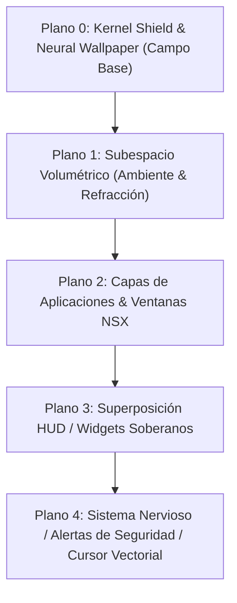

# 🌊 ESPECIFICACIÓN TÉCNICA: MODELO DE CAPAS VOLUMÉTRICAS NSX

**Versión:** 1.0.0-SOVEREIGN  
**Módulo:** Neuro Spatial eXperience (NSX) Volumetric Layering  
**Arquitectura:** 2D Advanced Spatial Field Compositor  

---

## 📐 1. Ecuación de Mezcla de Densidades Volumétricas

En el **Neuro-Espacio Soberano**, las capas visuales no se superponen mediante el algoritmo `Alpha Blending` tradicional ($C = \alpha A + (1-\alpha) B$).

En NSX, la luz y los elementos se componen según la **Función de Campo de Densidad Volumétrica ($\mathcal{D}_{NSX}$)**:

$$\mathcal{D}_{NSX}(p) = \sum_{i=1}^{N} \delta_i \cdot \mathcal{K}\left( \frac{\|p - p_i\|}{\sigma_i} \right)$$

Donde:
- $\delta_i$: Densidad de la capa soberana $i$ (`field_density`).
- $\mathcal{K}$: Núcleo Gaussian-Refractive de filtrado cibernético.
- $\sigma_i$: Radio de refracción e índice de masa de campo.

---

## 🎨 2. Jerarquía de Capas en el Espacio Soberano

---

## 🔮 3. Operadores de Refracción y Resonancia

### A. Refracción de Cristal Cibernético (Cyber Glass)
$$I_{\text{out}}(x,y) = \iint I_{\text{in}}(u,v) \cdot e^{-\frac{(x-u)^2+(y-v)^2}{2\sigma_{\text{refract}}^2}} \, du \, dv + \mathbf{\text{Glow}}_{\text{Neón}}$$

### B. Aberración Cromática de Seguridad
Cuando una ventana procesa transacciones cifradas o comunicación con la Hive, se activa un diferencial cromático ($\Delta \lambda$) en los bordes de la capa, indicando el aislamiento del sandbox en tiempo real.

---

*Especificación técnica aprobada para el Modelo de Capas Volumétricas de Neuro-OS.*
