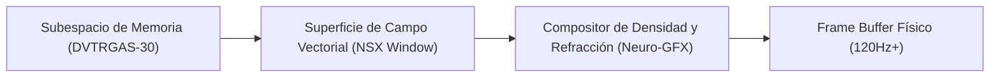
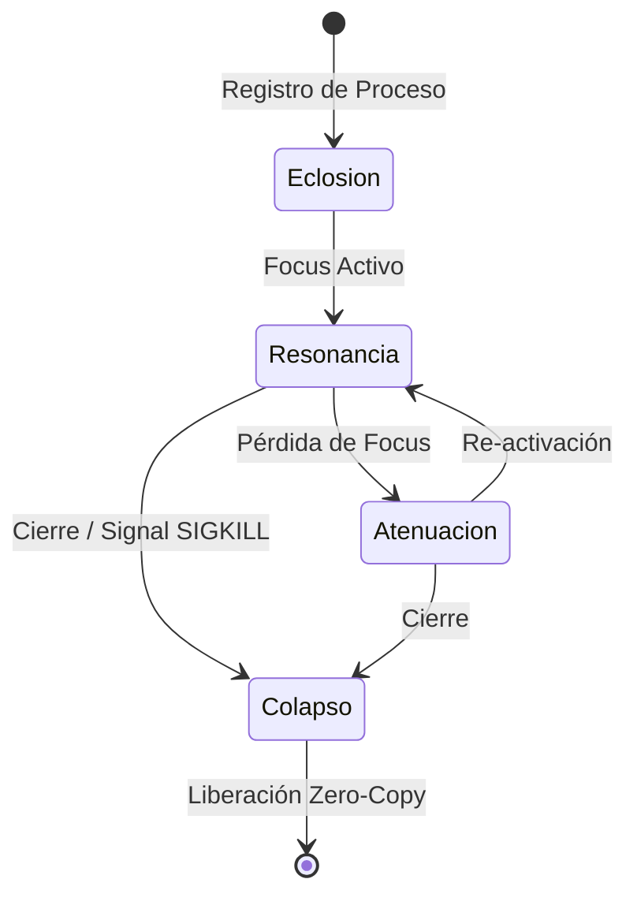

# 🧬 ESPECIFICACIÓN TÉCNICA: PROTOCOLO DE VENTANAS NSX (NEURO-ESPACIO SOBERANO)

**Versión:** 1.0.0-SOVEREIGN  
**Arquitectura Base:** 2D Advanced (Spatial Vector Engine)  
**Motor de Superficie:** Neuro-GFX Compositor + DVTRGAS-30  

---

## 📑 1. Principios del Protocolo de Ventanas NSX

En el **Neuro-Espacio Soberano (NSX)**, una "ventana" no es un rectángulo estático ni una proyección tridimensional trampa. Es un **Órgano Visual de Campo Densificado** que flota en un plano 2D avanzado continuo.



---

## ⚙️ 2. Atributos Fundamentales de la Ventana NSX

Cada superficie `NSXWindow` se rige por la siguiente estructura de atributos soberanos:

```json
{
  "window_id": "nsx.org.terminal.01",
  "spatial_bounds": {
    "x": 120,
    "y": 80,
    "width": 1024,
    "height": 728
  },
  "spatial_depth_level": 5,
  "field_density": 0.85,
  "refraction_index": 1.45,
  "aura_glow_color": "#00f2ff",
  "event_channel": "ipc://nsx/events/terminal.01"
}
```

### Definición de Parámetros:
1. **`spatial_depth_level` (Profundidad 2D Soberana)**: Orden xerárquico de composición (0 = Wallpaper de Campo, 100 = Ventana en Enfoque Supremo, 200 = Diálogo Crítico del Kernel).
2. **`field_density` (Masa Visual)**: Determina la opacidad estructural y el nivel de filtrado de luz de las capas inferiores.
3. **`refraction_index` (Refracción Cibernética)**: Nivel de desenfoque y aberración cromática aplicada por *Neuro-GFX Compositor* sobre los píxeles subyacentes.
4. **`aura_glow_color` (Resplandor Homeostático)**: Indica el estado energético y de seguridad de la ventana (Cian = Estable, Verde = Resonante, Magenta = Alta Actividad IA, Rojo = Alerta de Seguridad).

---

## 🔄 3. Ciclo de Vida de una Ventana NSX



1. **Eclosión (Ignición)**: La ventana emerge con una expansión cinemática de campo (*scale & blur fade* en <12ms).
2. **Resonancia (Foco Activo)**: La ventana adquiere el `spatial_depth_level` máximo de su categoría, incrementa su `refraction_index` y emite un `aura_glow_color` neón brillante.
3. **Atenuación (Fondo Espacial)**: La ventana disminuye su opacidad y suaviza sus bordes para dar prioridad visual al elemento activo sin desaparecer del flujo de trabajo.
4. **Colapso (Destrucción)**: Desintegración acelerada de la superficie y liberación inmediata del búfer de memoria compartida en **DVTRGAS-30**.

---

## ⚡ 4. Protocolo de Eventos Neurales Vectoriales

Los eventos en NSX no se calculan como clics en coordenadas absolutas de un sistema legacy, sino como **Vectores de Intención Neural (NIV)**:

- **`NIV_POINTER_PRESSURE`**: Mapea la intensidad de interacción para modificar temporalmente el `field_density`.
- **`NIV_SWIPE_FLUX`**: Desplazamiento vectorial fluido entre superficies adyacentes.
- **`NIV_RESONANCE_TRIGGER`**: Cambio dinámico de estado al pasar el cursor o invocar la IA Soberana.

---

## 🛠️ 5. Integración en el Código de Neuro-OS

El protocolo se expone en la API JavaScript de GXHTML a través de:

```javascript
// Crear o Registrar Ventana NSX
const win = window.NSX.createWindow({
    id: "quantum-monitor",
    title: "🖥️ MONITOR DE ENJAMBRE QUANTUM",
    width: 900,
    height: 600,
    density: 0.88,
    refraction: 1.5
});

// Activar Resonancia
win.focus();
```

---

*Especificación aprobada para la arquitectura gráfica definitiva de Neuro-OS.*
