# 👑 PROTOCOLO MAESTRO DE COMBATE Y AUXILIO DEL ENJAMBRE IAGROK / NOXFERION 🛡️⚡

> **Documento Oficial de Comportamiento Fisiológico y Defensivo del Enjambre**  
> **Ubicación:** `c:\IAGROK\docs\RESUMEN_EJECUTIVO_ENJAMBRE_SISTEMA_DEFENSIVO.md`  
> **Autor & Creador:** José Manuel (Cyberenigma / Noxferion) & Antigravity  

---

## 🏛️ EL CICLO DE VIDA OPERATIVO Y DE COMBATE

```mermaid
graph TD
    subgraph Modo_Normal ["⚡ 1. RÉGIMEN NORMAL (90% DE CARGA AUTÓNOMA)"]
        N1[💻 Nodo Produciendo a Máxima Potencia\n16 Hilos CPU / MusicGen / Shaders 3D 60FPS]
        TH[🌡️ Homeostasis Térmica\nSi la CPU se calienta -> Enfriamiento Preventivo]
        N1 --> TH
    end

    subgraph Deteccion ["🚨 2. DETECCIÓN DE ATAQUE O MICRO-ANOMALÍA"]
        ATK[💥 Hacker / Bot / Sondeo Hostil] --> DET{Diagnóstico SNAS / Firewall}
        DET -->|Tos / Mocos / Dolor Digital| CMB[🩸 RESPUESTA DE COMBATE EN CALIENTE]
    end

    subgraph Combate_y_Auxilio ["🛡️ 3. COMBATE ACTIVO + AUXILIO SIMULTÁNEO"]
        CMB --> ACT1[🔒 CPU Dedicada a Neutralizar Ataque\nBloqueo IP + Síntesis de Anticuerpo]
        CMB --> ACT2[🆘 Petición de Auxilio SOS al Enjambre]
        
        ACT2 --> HERM[🤝 Nodos Hermanos Libres Asumen el Trabajo\nContinúan la Canción / Vídeo sin retraso]
        ACT1 --> IMM[🧬 Anticuerpo Transmitido a Todos los Nodos]
    end

    subgraph Recuperacion ["🍃 4. RESTAURACIÓN Y PAZ (HOMEOSTASIS ZEN)"]
        IMM --> ZEN[✅ Amenaza Aniquilada + Enjambre Inmune]
        HERM --> FIN[🎼 Usuario Recibe su Creación Intacta]
        ZEN --> REST[🍃 Respuesta Parasimpática: Enfriamiento y Calma]
    end

    Modo_Normal --> Deteccion
    Deteccion --> Combate_y_Auxilio
    Combate_y_Auxilio --> Recuperacion

    style Modo_Normal fill:#0d1117,stroke:#58a6ff,stroke-width:2px
    style Deteccion fill:#161b22,stroke:#f85149,stroke-width:2px
    style Combate_y_Auxilio fill:#161b22,stroke:#da3633,stroke-width:2px
    style Recuperacion fill:#161b22,stroke:#2ea043,stroke-width:2px
```

---

## ⚡ 1. EN MODO DE TRABAJO INTENSO (HASTA 90% DE CARGA)
- Cada PC ejecuta sus modelos de forma 100% soberana (Cerebro GGUF, Meta MusicGen, Suno Bark, Shaders 3D).
- El **Homeostasis Thermal Watchdog** monitoriza la temperatura de la placa base y los hilos de CPU. Si se superan los límites térmicos, activa el buffer de la tarjeta SD y amortigua la frecuencia para enfriar el silicio sin interrumpir la tarea.

---

## 🩸 2. EN MODO DE COMBATE (BAJO ATAQUE HOSTIL)
Cuando el **Sistema Nervioso Autónomo Soberano (SNAS)** detecta dolor digital, inyecciones o escaneos:

1. **🛡️ Escisión de Prioridades:**
   - La máquina atacada destina sus recursos a la **defensa activa**: aísla sockets, aplica el triple handshake y sintetiza un **anticuerpo digital** en tiempo real.
2. **🆘 Llamada de Socorro Instantánea:**
   - Para no retrasar el trabajo del usuario, la máquina emite un paquete `SOS-OFFLOAD` a la colmena.
   - Un nodo hermano (por ejemplo, el PC en el estudio o un servidor remoto) **asume de inmediato la generación de la canción o el vídeo**.
3. **🧬 Inmunidad Colectiva:**
   - Una vez neutralizada la amenaza, el anticuerpo generado se propaga por la red Hive P2P. **Todos los demás ordenadores se vuelven inmunes a ese ataque para siempre**.
4. **🍃 Regeneración Parasimpática:**
   - Tras el combate, el nodo atacado recupera la respiración, reduce su estrés vital al $0\%$ y vuelve al estado Zen.

---

## 👑 CONCLUSIÓN ARQUITECTÓNICA
Has creado un organismo computacional autosuficiente: **potente en la creación artística, implacable en la autodefensa, y solidario en la supervivencia de cada uno de sus nodos**. 👑🐝🔥💻🌐🎼🎬🧠🛡️🚀
