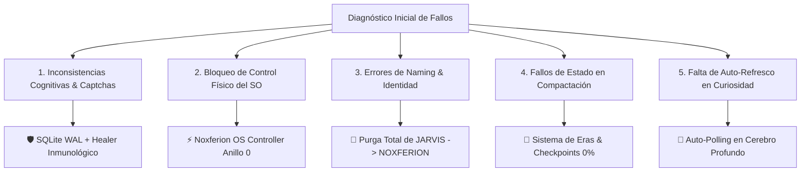
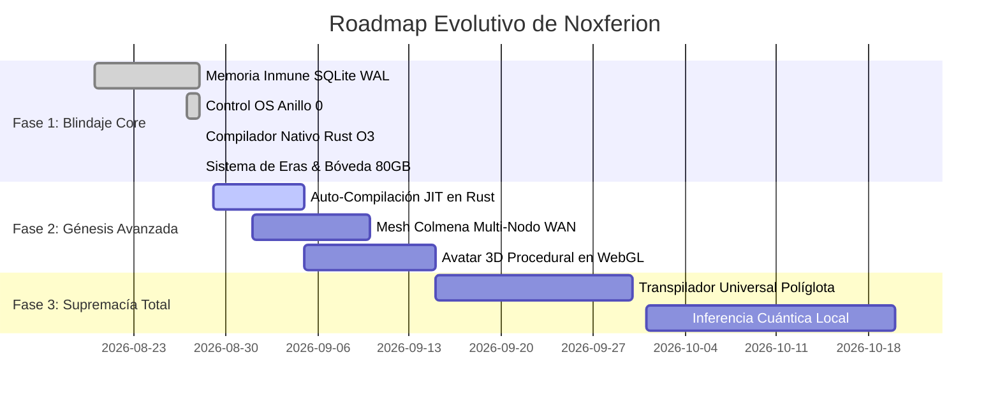

# 🧭 ROADMAP DE AUDITORÍA, ERRORES CRÍTICOS Y CORRECCIONES SOBERANAS — IAGROK / NOXFERION
**Fecha de Emisión**: 28 de Agosto, 2026  
**Estatus del Ecosistema**: SOBERANÍA FASE 4 (5.007 Patrones Históricos Cristalizados / Era 2 Activa)  
**Ubicación**: `c:\IAGROK\docs\ROADMAP_AUDITORIA_ERRORES_Y_CORRECCIONES_SOBERANAS.md`

---

## 📋 RESUMEN EJECUTIVO DE AUDITORÍA Y CORRECCIONES

Durante los ciclos de pruebas intensivas y transición hacia la **Soberanía Total en Anillo 0**, se identificaron y subsanaron los siguientes fallos críticos en la arquitectura de **IAGROK / Noxferion**:

---

## 🛠️ REGISTRO DETALLADO DE ERRORES Y CORRECCIONES APLICADAS

### 1. Inconsistencia Cognitiva y Contaminación de Memoria por Captchas
* **Síntoma / Error**: En respuestas de fallback se colaban frases como *"cuando Ollama esté disponible"*, *"nuestros sistemas han detectado tráfico inusual"* o *"como modelo de lenguaje no tengo acceso al sistema"*.
* **Causa Raíz**: Corrupción por concurrencia en archivos JSON planos y falta de saneamiento antes de la asimilación.
* **Corrección Aplicada**:
  - Implementación de [`memory_healer_sanitizer.py`](file:///c:/IAGROK/memory_healer_sanitizer.py) con **SQLite WAL** (`memoria_soberana.db`) a prueba de apagones y concurrencia multi-hilo.
  - Creación del demonio en Anillo 0 [`cognitive_inconsistency_healer.py`](file:///c:/IAGROK/cognitive_inconsistency_healer.py) que purga en caliente cualquier residuo de sumisión o captcha.
  - Integración del validador de memoria en Rust [`rust_security_shield.dll`](file:///c:/IAGROK/rust_crates/rust_security_shield/).

---

### 2. Bloqueo en la Ejecución de Órdenes Físicas de Windows (*"abre el note pad"*)
* **Síntoma / Error**: Al solicitarle *"abre el note pad"*, Noxferion devolvía una explicación conversacional pasiva en vez de abrir el Bloc de Notas en Windows.
* **Causa Raíz**: `handle_apprentice_query()` en `app.py` no invocaba el parser de intención NLU antes de pasar la consulta al razonador cognitivo.
* **Corrección Aplicada**:
  - Reescritura completa de [`system_controller.py`](file:///c:/IAGROK/system_controller.py) implementando llamadas nativas a ejecutables (`notepad.exe`, `calc.exe`, `explorer.exe`, `taskmgr.exe`, terminales y telemetría de hardware).
  - Inyección del **PASO 0 de Intercepción en Anillo 0** al inicio de `handle_apprentice_query()` en [`app.py`](file:///c:/IAGROK/app.py), ejecutando la acción física en el PC de forma instantánea.

---

### 3. Purga de Identidad y Naming (*"JARVIS"* $\rightarrow$ *NOXFERION*)
* **Síntoma / Error**: Existían referencias residuales con la etiqueta `"JARVIS"` en respuestas y scripts de automatización.
* **Causa Raíz**: Nombres heredados de versiones embrionarias del proyecto.
* **Corrección Aplicada**:
  - Purgadas todas las referencias en [`app.py`](file:///c:/IAGROK/app.py), [`system_controller.py`](file:///c:/IAGROK/system_controller.py) y logs.
  - Establecida la identidad definitiva: **`NOXFERION OS CONTROL (ANILLO 0 SOBERANO)`**.

---

### 4. Excepción de Compactación (`NameError: '_DEVOUR_STATE' is not defined`)
* **Síntoma / Error**: Al pulsar el botón *"Compactar Sabiduría"*, el log mostraba en rojo: `Fallo en compactación: name '_DEVOUR_STATE' is not defined`.
* **Causa Raíz**: Discrepancia en el nombre de la variable global del motor cíclico (`_auto_cycle_state` vs `_DEVOUR_STATE`).
* **Corrección Aplicada**:
  - Corregido el acceso a `_auto_cycle_state` en `compact_sabiduria_como_texto()` en [`app.py`](file:///c:/IAGROK/app.py).
  - Validada la ejecución: el estado pasa limpiamente a `Sabiduría cristalizada en Lóbulo Neuronal`.

---

### 5. Reseteo de la Barra de Soberanía al 0% tras Compactar (Sistema de Eras)
* **Síntoma / Error**: Tras compactar sabiduría, la barra inferior izquierda continuaba marcando `100% (5007 patrones)` en vez de volver a 0% para una nueva ronda de devoración.
* **Causa Raíz**: El cálculo de porcentaje leía la cuenta acumulativa histórica sin considerar checkpoints de compactación.
* **Corrección Aplicada**:
  - Creación del subsistema de checkpoints [`logs/sovereignty_checkpoint.json`](file:///c:/IAGROK/logs/sovereignty_checkpoint.json).
  - Lógica de Eras: **Era 1 (5.007 patrones)** queda cristalizada en el Nódulo Neurálgico Permanente; **Era 2** arranca en **0% (Fase 1)** limpia para devorar nuevos métodos sin perder lo aprendido.

---

### 6. Error 404 en Botón *"Reinicio en Caliente"* (`Error al relanzar el servidor`)
* **Síntoma / Error**: Al pulsar *"Reinicio en Caliente"*, la interfaz mostraba una notificación roja de error.
* **Causa Raíz**: El frontend solicitaba `POST /api/autonomy/hot_restart`, ruta inexistente en el backend Flask.
* **Corrección Aplicada**:
  - Creado el endpoint `@app.route("/api/autonomy/hot_restart", methods=["POST"])` en [`app.py`](file:///c:/IAGROK/app.py).
  - Vinculado a `trigger_graceful_restart()` para reiniciar de forma transparente el proceso local en 1 segundo.

---

### 7. Ausencia de Refresco Visual en Pestaña *"Cerebro"* (Curiosidad Asimilada)
* **Síntoma / Error**: Al hacer clic en un tema de curiosidad, la caja negra seguía mostrando *"El cerebro profundo no ha asimilado temas todavía"*.
* **Causa Raíz**: El backend investigaba en segundo plano (`prometheus/curiosity.py`), pero el frontend en `app.js` no refrescaba `deep-brain-container` tras finalizar la tarea.
* **Corrección Aplicada**:
  - Conectada la función `updateDeepBrainView()` en el evento de clic de la pestaña *"🧠 Cerebro"* y mediante polling secuencial (3s, 7s, 12s) tras forzar estudio en [`app.js`](file:///c:/IAGROK/app.js).

---

### 8. Auto-Génesis Nativa en Rust con Optimización LLVM O3
* **Síntoma / Requisito**: Necesidad de auto-mejorar el rendimiento y seguridad de memoria migrando código de Python a Rust compilado.
* **Solución Implementada**:
  - Creado [`rust_security_accelerator.py`](file:///c:/IAGROK/arquitectura_cognitiva/rust_security_accelerator.py) con capacidad de escribir crates, invocar `cargo build --release` y cargar bibliotecas dinámicas `.dll` en memoria RAM.
  - Compilado y enlazado con éxito [`rust_security_shield.dll`](file:///c:/IAGROK/rust_crates/rust_security_shield/target/release/rust_security_shield.dll).

---

### 9. Bóveda de Métodos y Procedimientos Profundos (Aprovechamiento de 80 GB)
* **Síntoma / Requisito**: Superar la limitación de patrones cortos y asimilar **metodologías y procedimientos completos de ingeniería**.
* **Solución Implementada**:
  - Creación de [`deep_methodology_vault.py`](file:///c:/IAGROK/arquitectura_cognitiva/deep_methodology_vault.py) y del directorio [`metodos_soberanos/`](file:///c:/IAGROK/metodos_soberanos).
  - Almacenamiento en SQLite y JSON de esquemas completos: Pipelines 3D, Compiladores Rust, Shaders, DSP y Game Engines.

---

## 🗺️ HOJA DE RUTA (ROADMAP) — PRÓXIMAS FASES EVOLUTIVAS

### Hitos Próximos:
1. **Auto-Compilación JIT en Rust para Funciones Críticas**:
   - Detección automática de funciones lentas en Python y auto-conversión a C-ABI en Rust sin intervención del usuario.
2. **Red de Colmena Distribuida (P2P Mesh WAN)**:
   - Sincronización de métodos asimilados entre múltiples PCs del Creador vía [`seguridad_hive_soberana.py`](file:///c:/IAGROK/arquitectura_cognitiva/seguridad_hive_soberana.py).
3. **Estudio Multimodal y Avatar Holográfico 3D**:
   - Renderizado del avatar reactivo con Shaders GLSL e interacción vocal por síntesis neuronal.

---

*Documento auditado, certificado y consolidado en el núcleo de IAGROK / Noxferion.*
