# 🏛️ SISTEMA COMPUTACIONAL AVANZADO HIVE & ESCUDO SOBERANO IMPENETRABLE 👑🛡️

> **Documento de Arquitectura de Computación Distribuida y Navegación Blindada**  
> **Ubicación:** `c:\IAGROK\docs\SISTEMA_COMPUTACIONAL_AVANZADO_HIVE_SHIELD.md`  
> **Creador:** José Manuel (Cyberenigma / Noxferion) & Antigravity  

---

## 🌌 1. LA VISIÓN: EL SUPER-COMPUTADOR DISTRIBUIDO (HIVE-MIND)

Cuando conectas 2, 3, 10 o 50 ordenadores ejecutando IAGROK, no tienes programas aislados: **tienes un único super-ordenador distribuido y descentralizado**.

Cada máquina aporta sus núcleos de CPU, su memoria RAM, sus motores neuronales y su almacenamiento, formando una **malla hiperconectada** donde los flujos de trabajo se reparten en milisegundos y los nodos se potencian mutuamente.

```mermaid
graph TD
    subgraph Malla ["⚡ MALLA COMPUTACIONAL HIVE (Pipeline Mesh)"]
        PC1[💻 Nodo 1 - Pamplona\nOrquestador y Chat LLM In-Process]
        PC2[💻 Nodo 2 - Estudio\nMeta MusicGen + Suno Bark]
        PC3[💻 Nodo 3 - Servidor\nOpenGL Shaders 3D + Optical Flow 60FPS]
        PC4[💻 Nodo 4...50 - Enjambre\nSeparación de Stems HPSS & DSP Master]
    end

    subgraph Flujo ["🎼 Flujo de Producción Paralelo"]
        F1[Etapa 1: Letra y Acordes] --> F2[Etapa 2: Síntesis Polifónica]
        F2 --> F3[Etapa 3: Canto y Voces]
        F3 --> F4[Etapa 4: Shaders 3D y Vídeo]
        F4 --> F5[Etapa 5: Master Final -14 LUFS]
    end

    subgraph Blindaje ["🛡️ ESCUDO FÍSICAMENTE IMPENETRABLE"]
        HW[Firma de Hardware Intransferible\nPlaca Base + CPU ID]
        ENC[Cifrado de Enlace AES-256-GCM]
        SBOX[Sandbox de Navegación Aislada]
        ISO[Protocolo de Auto-Cuarentena SOS]
    end

    PC1 <-->|Canal Cifrado| PC2
    PC2 <-->|Canal Cifrado| PC3
    PC3 <-->|Canal Cifrado| PC4

    Malla --> Flujo
    Malla --> Blindaje

    style Malla fill:#0d1117,stroke:#58a6ff,stroke-width:2px
    style Flujo fill:#161b22,stroke:#10b981,stroke-width:2px
    style Blindaje fill:#161b22,stroke:#f85149,stroke-width:2px
```

---

## ⚡ 2. REPARTO DE FLUJOS EN TIEMPO REAL (PIPELINE SHARING)

### A. Flujo de Producción Musical Distribuido:
1. **Nodo A:** Genera la letra en mandarín/español y los acordes armónicos.
2. **Nodo B:** Ejecuta `facebook/musicgen-small` generando la base polifónica (pianos y cuerdas).
3. **Nodo C:** Ejecuta `suno/bark-small` generando las líneas vocales con emoción y timbre juvenil.
4. **Nodo D:** Separa las pistas con HPSS (4 stems) y aplica Reverb analógica Schröder-Moorer.
5. **Nodo Local:** Mezcla, masteriza a $-14\text{ LUFS}$ y emite el archivo final.

### B. Flujo de Vídeo Cinemático 3D Distribuido:
1. **Nodo A:** Compila los Shaders GLSL reactivos al espectro sonoro.
2. **Nodo B:** Realiza la interpolación óptica Lucas-Kanade a 60 FPS frame a frame.
3. **Nodo Local:** Empaqueta y sincroniza el vídeo MP4 en alta definición.

---

## 🛡️ 3. EL ESCUDO DE NAVEGACIÓN Y BLINDAJE FÍSICO

Para garantizar que el ecosistema sea **físicamente impenetrable y seguro**:

1. **🔐 Huella de Hardware Intransferible:**  
   Cada clon está sellado a la placa base y procesador físico de su máquina. Copiar el software a otra máquina bloquea la ejecución en el acto.
2. **🔒 Validación por Triplicado (Triple Handshake):**  
   Todo mensaje entre ordenadores requiere Nonce temporal (anti-replay), firma HMAC-SHA256 y hash de integridad de archivos núcleo.
3. **🌐 Sandbox de Navegación Aislada:**  
   Cualquier petición web externa o sondeo de Curiosity Daemon se procesa en una capa aislada de memoria sin acceso directo al disco duro ni al sistema operativo.
4. **🚨 Protocolo de Auto-Aislamiento (Quarantine & SOS):**  
   Si una máquina detecta una firma inválida o un archivo alterado, se desconecta inmediatamente de la red para proteger al resto de la colmena y emite una alerta SOS solicitando una auto-reparación limpia.

---

## 👑 4. ESTADO TÉCNICO FINAL DEL ENJAMBRE SOBERANO

- **Arquitectura:** Red Hive Descentralizada P2P (Sin Servidor Central Obligatorio).
- **Multiplicador de Potencia:** $N \times$ Potencia de Cómputo (donde $N$ es el número de PCs conectados).
- **Cifrado de Enlace:** AES-256-GCM / HMAC-SHA256.
- **Resiliencia:** Cero Puntos Únicos de Fallo (Zero Single Point of Failure).
- **Soberanía:** 100% Offline, Local, Autónomo e Impenetrable.
