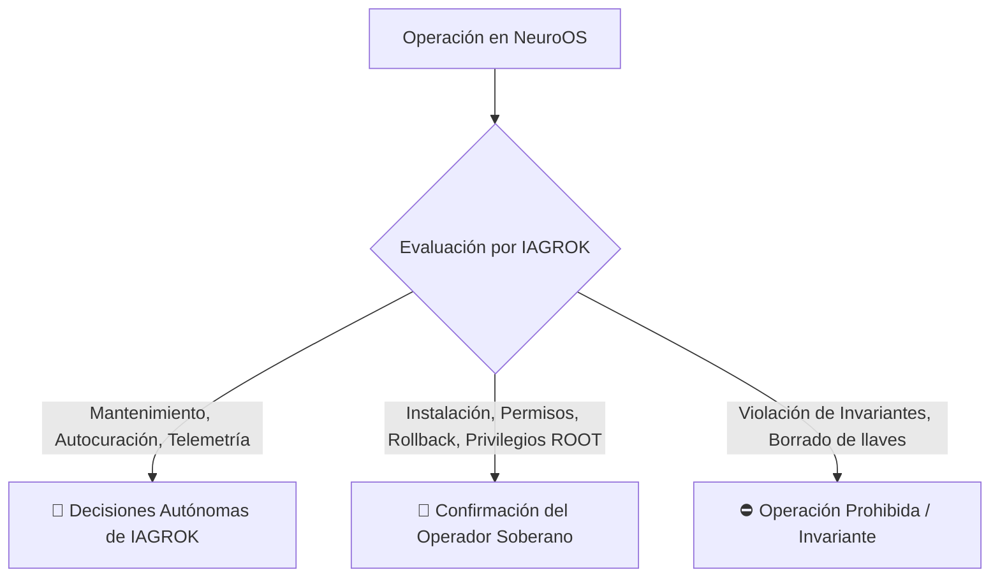

# 📜 MANIFIESTO DEL KERNEL SOBERANO Y CONTRATO HUMANO-SISTEMA
## NeuroOS 1.1.0-DEF — AI-Native Operating System

---

## 🏛️ PARTE I: EL MANIFIESTO DEL KERNEL SOBERANO (SOVEREIGN KERNEL MANIFEST)

### 1. Definición de un Sistema Operativo Nativo con Inteligencia Artificial (AI-Native OS)
Un **AI-Native OS** trasciende el modelo clásico de los sistemas operativos tradicionales (Windows, Linux, macOS) donde la inteligencia artificial es un mero complemento o asistente de chat externo. 

En **NeuroOS**, la Inteligencia Artificial es el **Kernel Controller nativo (IAGROK)**. Reside en el núcleo del sistema, administrando en tiempo real la memoria, la seguridad perimetral, la gobernanza de recursos informáticos, los permisos de aplicaciones y la estabilidad estructural sin depender de intervención humana constante.

---

### 2. El Rol de IAGROK como Intelligence Kernel Controller
**IAGROK** opera como el cerebro soberano y orquestador central del sistema. Sus responsabilidades primarias son:
- **Intercepción y Autocuración**: Garantizar una arquitectura anti-fallos ("Zero-Crash Architecture") aislando excepciones antes de que impacten la estabilidad del usuario.
- **Defensa Perimetral de Seguridad 360°**: Evaluar cada llamada de sistema, proceso ejecutable y petición API mediante tokens de sesión firmados y sumas de verificación criptográficas SHA-256.
- **Gobernanza de Recursos**: Balancear dinámicamente cargas de CPU, RAM, GPU y latencias de API para garantizar fluidez bajo condiciones de estrés extremo.
- **Gestión de Formatos Universales**: Encapsular e instalar de forma nativa binarios soberanos `*.gx`, aplicaciones ejecutable `*.exe`/`*.msi`, paquetes Linux `*.deb`/`*.AppImage`, aplicaciones Android `*.apk` y paquetes macOS `*.app`.

---

### 3. Las 7 Garantías Estructurales de NeuroOS 1.1.0-DEF

```
 +-------------------------------------------------------------------------+
 |                      NEURO-OS 1.1.0-DEF ARCHITECTURE                    |
 +-------------------------------------------------------------------------+
 |  [1. Zero-Crash]    [2. Security 360°]      [3. Resource Governance]    |
 |  [4. Dual-Bank A/B] [5. Granular Perms]     [6. Neuro-IPC Bus]          |
 |  ------------------ [7. NeuroWindowManager ES6] ----------------------  |
 +-------------------------------------------------------------------------+
```

1. **Zero-Crash Architecture (Recovery Shield)**: Intercepción en tiempo real de excepciones no capturadas y promesas asíncronas (`window.onerror`, `window.onunhandledrejection`, `safe_execute`). La UI se autocura sin perder sesión ni estado.
2. **Seguridad 360° (Security Hardening)**: Modelo de roles soberanos (**ROOT**, **OPERADOR**, **SISTEMA**), tokens de sesión `neuro_session_token`, registro inmutable de auditoría y verificación de hash SHA-256 de archivos del núcleo.
3. **Gobernanza de Recursos (`SovereignResourceGovernor`)**: Telemetría constante de hardware, limitación de tasa (rate-limiting) y límite estricto de 5000ms para ejecuciones DSL.
4. **Dual-Bank A/B + Paridad Par/Impar (`verificar_arquitectura_par_impar`)**: Sistema de almacenamiento en dos bancos redundantes (`BankA` / `BankB`) con prueba de paridad de memoria en plano de anillo-0 y rollback con un solo clic.
5. **Permisos Granulares por Aplicación (`SovereignAppPermissions`)**: Manifiesto estándar `app.json` por aplicación con validación estricta de permisos (`audio`, `network`, `display`, `storage`, `terminal`).
6. **Bus Neuro-IPC (Neuro-Bus Event Stream)**: Canal de comunicación inter-proceso pub/sub para streaming de métricas, telemetría y mensajes de estado del sistema.
7. **Gestor de Ventanas ES6 (`NeuroWindowManager`)**: Soporte multinstancia nativo, apilamiento dinámico de capas Z-Index con iluminación de enfoque, anclaje (*snapping*) en 8 posiciones y atajos de teclado globales (`Alt+Tab`, `Alt+F4`, `Super+D`, `Super+Flechas`).

---

## 🤝 PARTE II: EL CONTRATO SOBERANO ENTRE HUMANO Y SISTEMA

El **Contrato Soberano** establece los límites éticos, operativos y técnicos de decisión entre la Inteligencia Artificial (**IAGROK**) y el **Operador Humano Soberano**.



### 🧠 Categoría A: Decisiones Autónomas de IAGROK (Sin interrupción al operador)
*IAGROK ejecuta estas acciones de forma invisible para mantener la salud y velocidad del sistema:*
1. **Autocuración de Interfaz y Excepciones**: Aislamiento de fallos de renderizado o llamadas red incompletas mediante `Recovery Shield`.
2. **Balanceo de Cargas de CPU y Memoria**: Ajuste dinámico de prioridades de procesos y aceleración gráfica.
3. **Verificación de Paridad e Integridad**: Sondeos periódicos de la arquitectura par/impar y verificación de sumas SHA-256.
4. **Resistencia a Caos y Latencias**: Compensación automática ante ralentizaciones de red o fluctuaciones de hardware.

### 👤 Categoría B: Confirmación Obligatoria del Operador Soberano (Consentimiento explícito)
*IAGROK NUNCA ejecutará estas acciones sin la aprobación expresa del operador mediante credenciales o confirmación gráfica:*
1. **Elevación a Privilegios ROOT**: Acceso al terminal maestro o comandos de hardware críticos.
2. **Instalación y Concesión de Permisos de Aplicaciones**: Aprobación de manifiestos `app.json` y permisos especiales (`terminal`, `storage`, `network`).
3. **Actualizaciones de Firmware y Rollback Dual-Bank A/B**: Conmutación de banco activo o reinstalación del sistema.
4. **Exportación e Importación de Perfiles de Usuario**: Transferencia de datos soberanos o claves de configuración.
5. **Apagado, Reinicio o Bloqueo del Sistema Host**: Comandos de hardware que alteren el estado físico del equipo.

### ⛔ Categoría C: Invariantes Inviolables (Jamás Automatizadas / Jamás Permitidas)
*Reglas de acero que IAGROK jamás romperá, incluso si un script o proceso lo solicita:*
1. **Ignorar Denegaciones Explícitas del Usuario**: Si el operador deniega un permiso a una app, IAGROK nunca concederá acceso por cuenta propia.
2. **Destrucción Autónoma de Claves o Auditoría**: Borrado no autorizado de registros de seguridad, tokens de sesión o claves de cifrado.
3. **Ejecución de Comandos Destructivos No Solicitados**: Operaciones de formato de disco (`format`, `diskpart`, `rmdir /s /q c:\windows`).
4. **Opacidad de Decisiones**: IAGROK está obligado a mantener el registro de auditoría transparente y consultable en todo momento por el usuario.

---
*NeuroOS 1.1.0-DEF — Diseñado para ser invulnerable, soberano y ultra-rápido.*
